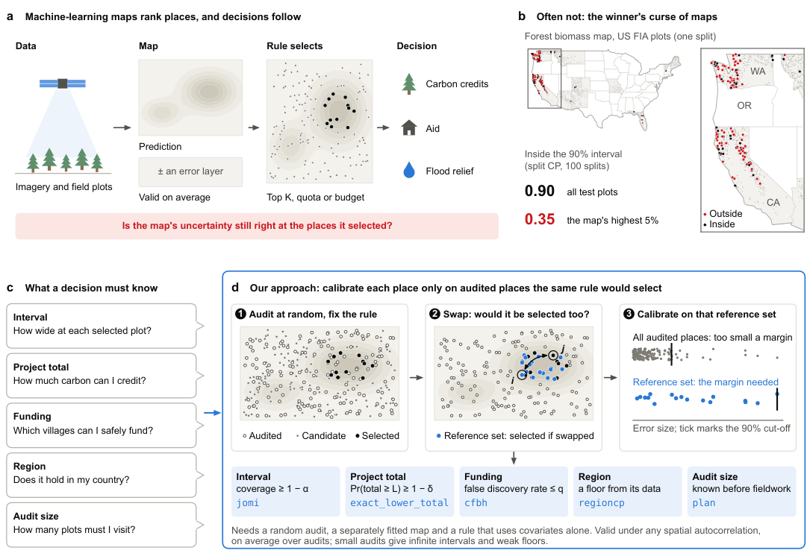
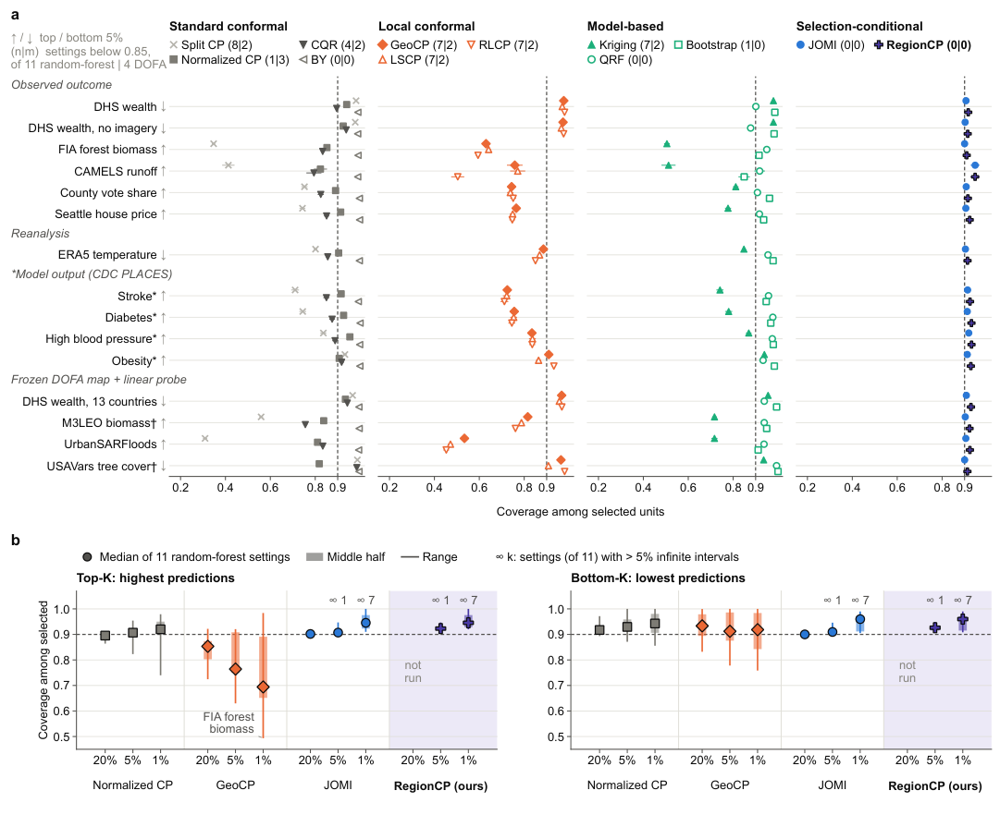
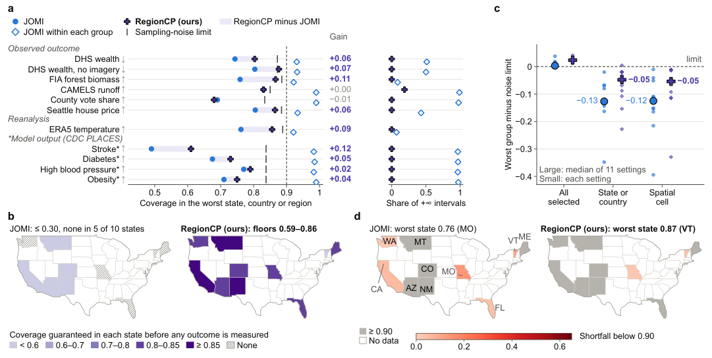
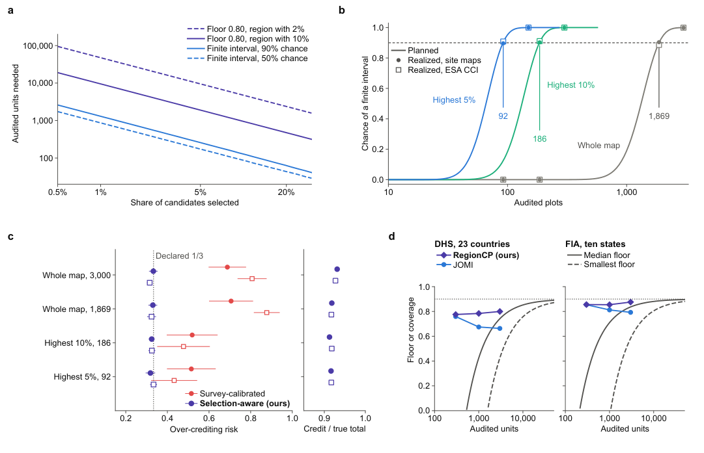

# Winner's curse of maps

Code, small data and figure data for the manuscript *Machine learning–based maps misstate their uncertainty where decisions are made* (2026).

Maps made by machine learning are used to choose places: the forest plots with the most carbon for credits, the poorest villages for aid. Intervals that are valid on average over a map can fail at exactly the places such a rule selects. The Python package **mapselect** (`package/`) calibrates each selected place only on audited places that the same rule would have selected, gives coverage floors for every region (RegionCP), bounds selected totals, and tells you before any field work how large the audit has to be. The rest of the repository holds every experiment, figure and test of the paper.



**The problem and the approach.** A rule selects places from a map (a); on a real map, split conformal intervals covered 0.35 of the forest plots ranked highest, against 0.90 of all plots (b); decisions need more than an interval (c); mapselect calibrates each selected place only on audited places that the same rule would select, and its functions are named in the boxes (d). Fig. 1 of the paper.

## Quick start
```bash
pip install ./package
python package/tests/test_mapselect.py   # 20 tests
python tests/test_planner.py             # the audit planner against enumeration
```
`package/README.md` shows the package in use. Python 3.11 with numpy, scipy, pandas, scikit-learn and matplotlib; rasterio for the ESA CCI extraction. Runs used at most four processes.

## What the paper finds


**Most uncertainty methods fall short at the places that maps select.** Coverage of 90% intervals among the selected places across ten data sources: split conformal fell below 0.85 for the selected 5% in ten of 15 settings, reference-set calibration (JOMI, RegionCP) in none. Fig. 2 of the paper.



**Coverage in every region.** Under quota rules, RegionCP raised coverage in the worst-covered state, country, climate region or zone from 0.74–0.81 with JOMI to 0.80–0.87, without more infinite intervals. Fig. 6 of the paper.



**The audit can be sized before any outcome is measured.** For a top-30 rule among 6,000 forest plots, 92 plots audited in the map's highest-predicted 5% gave finite intervals as planned, against 1,869 audited across the map. Fig. 7 of the paper.

## Results
Per-split and per-group results, logs and the result tables cited in the SI Appendix are in `QW2_results_for_review.zip` (about 150 MB), attached to the GitHub release because it exceeds GitHub's file-size limit. Unpack it so that `results/` sits at the top of the repository:
```bash
unzip QW2_results_for_review.zip 'QW2/results/*' && mv QW2/results results && rm -r QW2
```
Six of the seven main figures then redraw from these tables and `data/` (`python figures/make_fig_regions.py` draws Fig. 6; each script's docstring names its figure and inputs). Fig. 4 (aid targeting) also needs the DHS files, which are not shared, as do the supplementary figures built on the deep-backbone predictions.

## Contents
- `package/`: mapselect, the methods as an installable Python package (numpy, scipy; MIT licence). `pip install ./package`, then `python package/tests/test_mapselect.py` (20 tests); `python tests/test_planner.py` checks the audit planner against enumeration.
- `excp_select/`, `vendor/excp_20261021/`: the code behind the results (closed-form reference sets; SC-GeoCCP, which the paper calls RegionCP; total bounds) and the conformal engine it uses.
- `experiments/`: every run, summary and judgement script; each file's docstring gives its command and outputs.
- `figures/`: figure scripts, each naming its inputs in its docstring; `figs/source_data/`: figure data under working names (Dataset S1 of the paper holds the same data under the final figure numbers).
- `tests/`: brute-force swap, Monte Carlo coverage, pool-lemma and SC-GeoCCP checks.
- `results/` (the results archive; see Results above): per-split and per-group results, logs and the `RESULTS_*.md` tables cited in the SI Appendix; `results/cache/*_frozen*` hold the designs frozen before each run, with SHA-256 digests (the design notes are in Chinese); `results/cache/` also keeps the FIA and ESA CCI extraction logs, the checksums of the raw downloads and the swap-test log. In logs, local paths are shortened to `QW2/` and `~/`.
- `data/`: the FIA plot table rebuilt from FIADB 9.5 and the ESA CCI values at the plots; Natural Earth boundaries.
- `website/`: the interactive site and the script that builds its data.

## Not included
- DHS data: the cluster table, unit-level predictions and labels, and the deep-backbone prediction files, under the DHS terms (access: https://dhsprogram.com; PovertyMap-WILDS). DHS results appear only as country and split summaries: rows for spatial cells were removed, and the pilot's per-village table `results/pilot_l2_poverty_lab.csv` is replaced by its summary by country and split (selected, covered and finite counts, median and mean finite half-width, mean reference-set size).
- Unit-level files of the other sources, except the FIA split behind Fig. 1b (`results/units_fia_db_rep0.npz`).
- Raw downloads (FIADB state files, ESA CCI tiles, WILDS image features) and the run cache; the scripts give their sources.
- Other data sources (ERA5, CAMELS, county vote share, King County sales, CDC PLACES) are read from their published tables; see the data-source table of the SI Appendix.

## Data read by the scripts
Included, under their own terms:
- `data/fia_fiadb95_plots.csv`: forest plots rebuilt from the USDA Forest Service FIA database by `experiments/build_fia_fiadb.py` (FIADB 9.5; https://doi.org/10.2737/RDS-2001-FIADB; public domain).
- `data/fia_cci_v7_2020.csv`: ESA CCI Biomass v7.0 (2020) at those plots, by `experiments/build_fia_cci.py` (https://doi.org/10.5285/6429d1aafe1e43b9b414e4a5a7f8b903), under the Biomass CCI terms, which require acknowledging the ESA Climate Change Initiative and the Biomass CCI project.
- `data/natural_earth_110m_v5.1.2/`: Natural Earth boundaries (public domain).

The other loaders in `experiments/data.py` read the published source tables (file names in `experiments/data.py`; sources, versions and licences in the data-source table of the SI Appendix) from the folder set by `RES` and `DS` at the top of `experiments/data.py`, two levels above this repository as the runs were made; point them to your copy of the tables, which are not redistributed here.
`experiments/data.py` is kept as it was run, because its SHA-256 digest is part of a preregistration record (`results/cache/DOFA_FORMAL_FROZEN_SHA256.txt`). PovertyMap-WILDS features are read from `~/data/wilds`; DHS data are available from the DHS Program on registration and are not shared here.

## Licence
- Code: MIT (`LICENSE`), including `package/` and `vendor/excp_20261021/`, a copy of the author's conformal-inference package (imported as `excp`; current name geounicp).
- Results, logs and figure data made in this study (`results/`, `figs/source_data/`): CC BY 4.0.
- Data in `data/`: their own terms, listed above.

## Citation
`CITATION.cff` gives the citation of this code; the article reference will be added on publication.

## Working codes in the code and notes
Scripts and result tables use working labels for supplementary items. Their final labels, as in the PDFs (sub-tables and figure panels keep their letters; sections of a note keep their numbers):

| Working label | Final |
|---|---|
| [SN1], Supplementary Note 1; sections S1.x | SI Appendix, section S1 |
| [SN2], Supplementary Note 2; sections S2.x | SI Appendix, section S2 |
| [S1] | SI Appendix, section S3 |
| [S31] | SI Appendix, section S4 |
| [SN3], Supplementary Note 3; sections SN3.x | SI Appendix, section S5 |
| [S21] | SI Appendix, section S6 |
| [S32] | SI Appendix, section S7 |
| [S2], [S3] | SI Appendix, section S8 |
| [S19] | SI Appendix, section S9 |
| [S23] | SI Appendix, section S10 |
| [S29] | SI Appendix, section S11 |
| [S24] | SI Appendix, section S12 |
| [S25] | SI Appendix, section S13 |
| [S33] | SI Appendix, section S14 |
| [S30] | SI Appendix, section S15 |
| [S6] | SI Appendix, section S16 |
| [S22] | SI Appendix, section S17 |
| [S20] | SI Appendix, section S18 |
| [S16] | SI Appendix, section S19 |
| [S26] | SI Appendix, section S20 |
| [S18] | SI Appendix, section S21 |
| [S11] | SI Appendix, section S22 |
| [S27] | SI Appendix, section S23 |
| [S28] | SI Appendix, section S24 |
| Table S1 | SI Appendix, Table S1 |
| Supplementary Table [S#: data sources] | SI Appendix, Table S2 |
| Table SN3.1 | SI Appendix, Table S3 |
| Table S21 | SI Appendix, Table S4 |
| Table S19 | SI Appendix, Table S5 |
| Table S23 | SI Appendix, Table S6 |
| Table S29 | SI Appendix, Table S7 |
| Table S24 | SI Appendix, Table S8 |
| Table S25 | SI Appendix, Table S9 |
| Table S33 | SI Appendix, Table S10 |
| Table S6 | SI Appendix, Table S11 |
| Table S22 | SI Appendix, Table S12 |
| Table S20 | SI Appendix, Table S13 |
| Table S18 | SI Appendix, Table S14 |
| Table S11 | SI Appendix, Table S15 |
| Supplementary Fig. 25 | SI Appendix, Fig. S1 |
| Supplementary Fig. 9 | SI Appendix, Fig. S2 |
| Supplementary Fig. 15 | SI Appendix, Fig. S3 |
| Supplementary Fig. 2 | SI Appendix, Fig. S4 |
| Supplementary Fig. 28 | SI Appendix, Fig. S5 |
| Supplementary Fig. 23 | SI Appendix, Fig. S6 |
| Supplementary Fig. 22 | SI Appendix, Fig. S7 |
| Supplementary Fig. 24 | SI Appendix, Fig. S8 |
| Supplementary Fig. 29 | SI Appendix, Fig. S9 |
| Supplementary Fig. 27 | SI Appendix, Fig. S10 |
| Supplementary Fig. 31 | SI Appendix, Fig. S11 |
